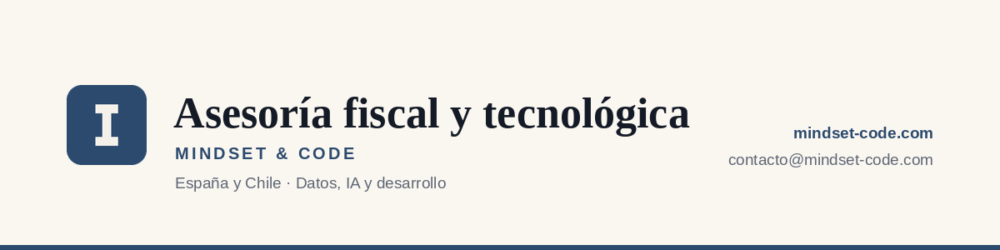

  

  <a href="https://github.com/mindset-code/.github/blob/main/profile/README.md">Castellano</a> · <a href="https://github.com/mindset-code/.github/blob/main/profile/README.en.md">English</a> · <b>Català</b>

  
  
  
  

---

Automatitzem el que avui es fa a mà, convertim les teves dades en un panell que s'entén i construïm el web que les ensenya. Per a autònoms i pimes, amb el preu publicat abans de la primera trucada.

- **El preu va al davant** → cada encàrrec porta abast, import i termini tancats per escrit, sense trucada comercial prèvia
- **Resposta en menys de 24 h laborables**, per escrit, i sempre el mateix interlocutor
- **Aquesta organització és la prova de la feina:** 12 repositoris de projecte —cadascun amb el seu codi, el seu historial, les seves dates i la seva wiki— i tres biblioteques que s'instal·len i s'usen

---

## Què pots contractar

| Àrea | Què inclou | Fitxa |
| :--- | :--- | :--- |
| **Anàlisi de dades i BI** | Power BI · Python · quadres de comandament | [veure](https://mindset-code.com/ca/services/analisis-datos-bi) |
| **IA i automatització** | LLMs · n8n · processos que treballen sols | [veure](https://mindset-code.com/ca/services/ia-automatizacion) |
| **Desenvolupament full-stack** | React · FastAPI · aplicacions a mida | [veure](https://mindset-code.com/ca/services/desarrollo-full-stack) |
| **Disseny web i e-commerce** | Headless · SEO · botiga en línia | [veure](https://mindset-code.com/ca/services/diseno-web) |
| **Arquitectura cloud** | GCP · AWS · infraestructura com a codi | [veure](https://mindset-code.com/ca/services/arquitectura-cloud) |
| **Seguretat** | OWASP · CVSS · auditoria de vulnerabilitats | [veure](https://mindset-code.com/ca/services/seguridad) |
| **Compliment d'IA i dades** | RGPD · Reglament europeu d'IA | [veure](https://mindset-code.com/ca/services/cumplimiento-ia-datos) |
| **Atenció al client** | Agents d'IA · temps de primera resposta | [veure](https://mindset-code.com/ca/services/atencion-cliente) |
| **Formació en IA** | Sessions per a qui fa la feina, no per al comitè | [veure](https://mindset-code.com/ca/services/formacion-ia) |
| **Màrqueting digital** | Analítica sense galetes · contingut · SEO tècnic | [veure](https://mindset-code.com/ca/services/marketing-digital) |
| **Propostes i copy** | Textos que expliquen què es compra i què costa | [veure](https://mindset-code.com/ca/services/propuestas-copy) |

---

## Per on començar

Encàrrecs amb **abast, preu i termini tancats per escrit**, sense trucada comercial prèvia.

| Si estàs en aquesta situació | Encàrrec |
| :--- | :--- |
| Se me'n va la vida teclejant factures | [Captura automàtica de factures](https://mindset-code.com/ca/encargo/captura-facturas) |
| No sé quant cobraré el mes que ve | [Panell de tresoreria](https://mindset-code.com/ca/encargo/panel-tesoreria) |
| Sento parlar d'IA i no sé què em serveix a mi | [Què pots automatitzar amb IA](https://mindset-code.com/ca/encargo/auditoria-ia) |
| La factura del núvol no para de pujar | [Revisió de la teva factura del núvol](https://mindset-code.com/ca/encargo/factura-cloud) |
| El meu web va lent i no sé per on començar | [Auditoria tècnica del teu web](https://mindset-code.com/ca/encargo/revision-web) |
| Ningú actualitza el meu web des de fa mesos | [El teu web al dia](https://mindset-code.com/ca/encargo/web-al-dia) |

→ **[Veure tots els encàrrecs amb preu tancat](https://mindset-code.com/ca/express)**

---

## La feina, publicada

Ningú no té per què creure's el que un web diu de si mateix. Cada projecte és obert: es llegeix el codi sencer, amb el seu historial i les seves dates, i dona suport a un servei del catàleg.

Cada fila enllaça la seva **fitxa** —quin problema resol, què fa i amb què està construït— i des d'allà s'obre la demo i el repositori. Cada repositori porta a més la seva **wiki**, amb l'arquitectura i les decisions de disseny.

### Dades, BI i models predictius

| Projecte | Què resol | Stack |
| :--- | :--- | :--- |
| [Quadre de comandament executiu](https://mindset-code.com/ca/codigo/cuadro-de-mando-ejecutivo) | 24 indicadors de direcció que quadren entre si, en quatre dominis de negoci | Python · React · Recharts |
| [Fuga de clients](https://mindset-code.com/ca/codigo/fuga-de-clientes) | Regressió logística que assenyala qui se'n va i què l'empeny — AUC-ROC 0,703, reproduïble amb el codi i les dades del repositori | scikit-learn · Python · React |
| [ETL de vendes i meteorologia](https://mindset-code.com/ca/codigo/etl-ventas-meteorologia) | Creua 2,9 M de registres de clima amb 9.800 transaccions de venda | Python · Pandas · Firebase |
| [Rendibilitat per SQL](https://mindset-code.com/ca/codigo/rentabilidad-por-sql) | Deu mil línies de venda tallades per producte, regió i descompte | SQL · Python · Power BI |
| [Motor de preus hoteler](https://mindset-code.com/ca/codigo/motor-de-precios-hotelero) | Sis senyals de demanda fixen la tarifa de cada nit, amb previsió a 60 dies | Python · NumPy · React |

### IA, automatització i producte

| Projecte | Què resol | Stack |
| :--- | :--- | :--- |
| [AgentForge](https://mindset-code.com/ca/codigo/agentforge) | Infraestructura per desplegar un agent d'IA per client, amb memòria persistent | React · Firebase · n8n · Claude |
| [Web cinemàtic](https://mindset-code.com/ca/codigo/web-cinematica) | Converteix un web pla en una landing amb moviment construït en codi, no en vídeo | Vite · React · GSAP · R3F |
| [Restaurant en 3D](https://mindset-code.com/ca/codigo/restaurante-3d) | Models tridimensionals reals sense penalitzar la càrrega | React · Three.js · GSAP |
| [Simulador d'ingressos](https://mindset-code.com/ca/codigo/simulador-de-ingresos) | Les palanques del preu, en lliscadors que recalculen a l'instant | HTML · CSS · JavaScript |
| [Portafolis interactiu](https://mindset-code.com/ca/codigo/portafolio-interactivo) | Reuneix els projectes en un sol lloc, amb els quadres de comandament llegint les dades que cada repositori publica | React · Vite · Recharts · Firebase |

### Biblioteques

| Projecte | Què resol | Stack |
| :--- | :--- | :--- |
| [verifactu-huella](https://github.com/mindset-code/pyverifactu-huella) | L’empremta SHA-256 encadenada que l’AEAT exigeix a tot programari de facturació abans del 2027 · reprodueix el vector de prova oficial | Python · zero dependències |
| [calendario-fiscal-es](https://github.com/mindset-code/calendario-fiscal-es) | Quan venç cada model de l’AEAT · trasllada a dia hàbil, distingeix l’asimetria del 4T i resta els cinc dies de la domiciliació | Python · zero dependències |
| [facturae-es](https://github.com/mindset-code/facturae-es) | L'XML de Facturae 3.2.2 que el RD 238/2026 fa obligatori · els totals surten de les línies i l'ordre es valida contra l'esquema del Ministeri | Python · zero dependències |

### Seguretat

| Projecte | Què resol | Stack |
| :--- | :--- | :--- |
| [Anàlisi de registres](https://mindset-code.com/ca/codigo/analisis-de-logs) | Analitza 5.000 esdeveniments de seguretat sintètics i els resumeix en un informe d'incidents amb quatre taules | Python · biblioteca estàndard |
| [Escàner de vulnerabilitats](https://mindset-code.com/ca/codigo/escaner-de-vulnerabilidades) | Simula un escaneig de ports i converteix els oberts en troballes prioritzades, amb la seva severitat i la seva mitigació | Python · biblioteca estàndard |

> Són projectes propis, no encàrrecs de clients: les dades són sintètiques o públiques i no contenen informació de ningú. El que es pot comprovar és el codi, que hi és sencer.

---

## Formació i certificacions

| Titulació | Centre | Any |
| :--- | :--- | :--- |
| **Generative AI Engineering** (16 cursos) | IBM | 2026 |
| **Full Stack Software Developer** (15 cursos) | IBM | 2026 |
| **DevOps and Software Engineering** (15 cursos) | IBM | 2026 |
| **Cybersecurity** (8 cursos) | Google | 2024 |
| **IT Support** (5 cursos) | Google | 2024 |
| **Màster en Big Data & Business Intelligence** | Universidad Isabel I | 2021–2022 |
| **MBA** — Master in Business Administration | Indiana Tech | 2022–2023 |
| **Enginyeria Comercial** | Universidad de Las Américas | 2017–2019 |

---

## En parlem

| | |
| :--- | :--- |
| **Web** | [mindset-code.com](https://mindset-code.com/ca) |
| **Correu** | contacto@mindset-code.com |
| **Telèfon** | +34 673 907 055 |
| **On** | El Prat de Llobregat, Barcelona · i en remot |
| **Primera trucada** | 60 minuts, sense cost i sense comercial pel mig — [demanar cita](https://mindset-code.com/ca/cita) |

  <a href="https://mindset-code.com/">Castellano</a> · <a href="https://mindset-code.com/en">English</a> · <a href="https://mindset-code.com/ca">Català</a> · <a href="https://mindset-code.com/aviso-legal">Condicions generals</a> · <a href="https://mindset-code.com/privacidad">Privacitat</a>

