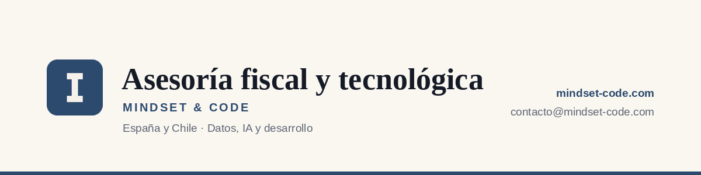

  

  <a href="https://github.com/mindset-code/.github/blob/main/profile/README.md">Castellano</a> · <b>English</b> · <a href="https://github.com/mindset-code/.github/blob/main/profile/README.ca.md">Català</a>

  
  
  
  

---

We automate what you still do by hand, turn your data into a dashboard you can actually read, and build the website that shows it. For freelancers and small companies, with the price published before the first call.

- **The price comes first** → every engagement states scope, amount and deadline in writing, with no sales call beforehand
- **A written answer within 24 working hours**, always from the same person
- **This organisation is the proof of the work:** 12 project repositories —each with its code, its history, its dates and its wiki— plus three libraries you can install and use

---

## What you can hire

| Area | What it covers | Details |
| :--- | :--- | :--- |
| **Data analysis and BI** | Power BI · Python · dashboards | [see](https://mindset-code.com/en/services/analisis-datos-bi) |
| **AI and automation** | LLMs · n8n · processes that run themselves | [see](https://mindset-code.com/en/services/ia-automatizacion) |
| **Full-stack development** | React · FastAPI · custom applications | [see](https://mindset-code.com/en/services/desarrollo-full-stack) |
| **Web design and e-commerce** | Headless · SEO · online shop | [see](https://mindset-code.com/en/services/diseno-web) |
| **Cloud architecture** | GCP · AWS · infrastructure as code | [see](https://mindset-code.com/en/services/arquitectura-cloud) |
| **Security** | OWASP · CVSS · vulnerability assessment | [see](https://mindset-code.com/en/services/seguridad) |
| **AI and data compliance** | GDPR · EU AI Act | [see](https://mindset-code.com/en/services/cumplimiento-ia-datos) |
| **Customer service** | AI agents · first response time | [see](https://mindset-code.com/en/services/atencion-cliente) |
| **AI training** | Sessions for the people doing the work, not for the committee | [see](https://mindset-code.com/en/services/formacion-ia) |
| **Digital marketing** | Cookieless analytics · content · technical SEO | [see](https://mindset-code.com/en/services/marketing-digital) |
| **Proposals and copy** | Text that explains what is being bought and what it costs | [see](https://mindset-code.com/en/services/propuestas-copy) |

---

## Where to start

Engagements with **scope, price and deadline closed in writing**, with no sales call beforehand.

| If this is your situation | Engagement |
| :--- | :--- |
| I spend my life typing in invoices | [Automatic invoice capture](https://mindset-code.com/en/encargo/captura-facturas) |
| I don't know what I'll be paid next month | [Cash-flow dashboard](https://mindset-code.com/en/encargo/panel-tesoreria) |
| Everyone talks about AI and I don't know what's useful to me | [What you can automate with AI](https://mindset-code.com/en/encargo/auditoria-ia) |
| My cloud bill keeps going up | [Cloud bill review](https://mindset-code.com/en/encargo/factura-cloud) |
| My site is slow and I don't know where to start | [Technical website audit](https://mindset-code.com/en/encargo/revision-web) |
| Nobody has updated my website in months | [Your website kept up to date](https://mindset-code.com/en/encargo/web-al-dia) |

→ **[See every fixed-price engagement](https://mindset-code.com/en/express)**

---

## The work, published

Nobody has to take a website's word for itself. Every project is open: you can read the whole codebase, with its history and its dates, and it backs a service in the catalogue.

Each row links to its **page** —what problem it solves, what it does and what it is built with— and from there the demo and the repository. Every repository also has a **wiki** covering the architecture and the design decisions.

### Data, BI and predictive models

| Project | What it solves | Stack |
| :--- | :--- | :--- |
| [Executive dashboard](https://mindset-code.com/en/codigo/cuadro-de-mando-ejecutivo) | 24 management indicators that reconcile with each other, across four business domains | Python · React · Recharts |
| [Customer churn](https://mindset-code.com/en/codigo/fuga-de-clientes) | Logistic regression that flags who is leaving and what pushes them — AUC-ROC 0.703, reproducible with the code and data in the repository | scikit-learn · Python · React |
| [Sales and weather ETL](https://mindset-code.com/en/codigo/etl-ventas-meteorologia) | Cross-references 2.9 M weather records with 9,800 sales transactions | Python · Pandas · Firebase |
| [Profitability in SQL](https://mindset-code.com/en/codigo/rentabilidad-por-sql) | Ten thousand sales lines cut by product, region and discount | SQL · Python · Power BI |
| [Hotel pricing engine](https://mindset-code.com/en/codigo/motor-de-precios-hotelero) | Six demand signals set the rate for each night, with a 60-day forecast | Python · NumPy · React |

### AI, automation and product

| Project | What it solves | Stack |
| :--- | :--- | :--- |
| [AgentForge](https://mindset-code.com/en/codigo/agentforge) | Infrastructure to deploy one AI agent per client, with persistent memory | React · Firebase · n8n · Claude |
| [Cinematic web](https://mindset-code.com/en/codigo/web-cinematica) | Turns a flat website into a landing page with motion built in code, not in video | Vite · React · GSAP · R3F |
| [3D restaurant](https://mindset-code.com/en/codigo/restaurante-3d) | Real three-dimensional models without paying for it in load time | React · Three.js · GSAP |
| [Revenue simulator](https://mindset-code.com/en/codigo/simulador-de-ingresos) | The pricing levers, as sliders that recalculate instantly | HTML · CSS · JavaScript |
| [Interactive portfolio](https://mindset-code.com/en/codigo/portafolio-interactivo) | Brings the projects together in one place, with the dashboards reading the data each repository publishes | React · Vite · Recharts · Firebase |

### Libraries

| Project | What it solves | Stack |
| :--- | :--- | :--- |
| [verifactu-huella](https://github.com/mindset-code/verifactu-huella) | The chained SHA-256 hash that Spain’s tax agency requires from every invoicing system before 2027 · reproduces the official test vector | Python · zero dependencies |
| [calendario-fiscal-es](https://github.com/mindset-code/calendario-fiscal-es) | When each Spanish tax form is due · shifts to the next working day, handles the Q4 asymmetry and subtracts the five days of direct debit | Python · zero dependencies |
| [facturae-es](https://github.com/mindset-code/facturae-es) | The Facturae 3.2.2 XML that Spain's RD 238/2026 makes mandatory · totals derived from the lines, element order checked against the official schema | Python · zero dependencies |

### Security

| Project | What it solves | Stack |
| :--- | :--- | :--- |
| [Log analysis](https://mindset-code.com/en/codigo/analisis-de-logs) | Parses 5,000 synthetic security events and summarises them into an incident report with four tables | Python · standard library |
| [Vulnerability scanner](https://mindset-code.com/en/codigo/escaner-de-vulnerabilidades) | Simulates a port scan and turns the open ports into prioritised findings, with severity and mitigation | Python · standard library |

> These are our own projects, not client work: the data is synthetic or public and contains nobody's information. What can be checked is the code, and it is all there.

---

## Training and certifications

| Qualification | Institution | Year |
| :--- | :--- | :--- |
| **Generative AI Engineering** (16 courses) | IBM | 2026 |
| **Full Stack Software Developer** (15 courses) | IBM | 2026 |
| **DevOps and Software Engineering** (15 courses) | IBM | 2026 |
| **Cybersecurity** (8 courses) | Google | 2024 |
| **IT Support** (5 courses) | Google | 2024 |
| **MSc in Big Data & Business Intelligence** | Universidad Isabel I | 2021–2022 |
| **MBA** — Master in Business Administration | Indiana Tech | 2022–2023 |
| **BSc in Business Administration** | Universidad de Las Américas | 2017–2019 |

---

## Get in touch

| | |
| :--- | :--- |
| **Web** | [mindset-code.com](https://mindset-code.com/en) |
| **Email** | contacto@mindset-code.com |
| **Phone** | +34 673 907 048 |
| **Where** | El Prat de Llobregat, Barcelona · and remotely |
| **First call** | 60 minutes, free and with no salesperson involved — [book](https://mindset-code.com/en/cita) |

  <a href="https://mindset-code.com/">Castellano</a> · <a href="https://mindset-code.com/en">English</a> · <a href="https://mindset-code.com/ca">Català</a> · <a href="https://mindset-code.com/aviso-legal">Terms</a> · <a href="https://mindset-code.com/privacidad">Privacy</a>

