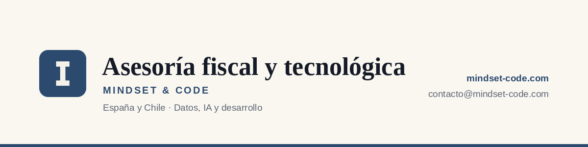

  

  <b>Castellano</b> · <a href="https://github.com/mindset-code/.github/blob/main/profile/README.en.md">English</a> · <a href="https://github.com/mindset-code/.github/blob/main/profile/README.ca.md">Català</a>

  
  
  
  

---

Automatizamos lo que hoy se hace a mano, convertimos tus datos en un panel que se entiende y construimos la web que los enseña. Para autónomos y pymes, con el precio publicado antes de la primera llamada.

- **El precio va por delante** → cada encargo lleva alcance, importe y plazo cerrados por escrito, sin llamada comercial previa
- **Respuesta en menos de 24 h laborables**, por escrito, y siempre el mismo interlocutor
- **Esta organización es la prueba del trabajo:** 12 repositorios de proyecto —cada uno con su código, su historial, sus fechas y su wiki— y tres bibliotecas que se instalan y se usan

---

## Qué puedes contratar

| Área | Qué incluye | Ficha |
| :--- | :--- | :--- |
| **Análisis de datos y BI** | Power BI · Python · cuadros de mando | [ver](https://mindset-code.com/services/analisis-datos-bi) |
| **IA y automatización** | LLMs · n8n · procesos que trabajan solos | [ver](https://mindset-code.com/services/ia-automatizacion) |
| **Desarrollo full-stack** | React · FastAPI · aplicaciones a medida | [ver](https://mindset-code.com/services/desarrollo-full-stack) |
| **Diseño web y e-commerce** | Headless · SEO · tienda online | [ver](https://mindset-code.com/services/diseno-web) |
| **Arquitectura cloud** | GCP · AWS · infraestructura como código | [ver](https://mindset-code.com/services/arquitectura-cloud) |
| **Seguridad** | OWASP · CVSS · auditoría de vulnerabilidades | [ver](https://mindset-code.com/services/seguridad) |
| **Cumplimiento de IA y datos** | RGPD · Reglamento europeo de IA | [ver](https://mindset-code.com/services/cumplimiento-ia-datos) |
| **Atención al cliente** | Agentes de IA · tiempo de primera respuesta | [ver](https://mindset-code.com/services/atencion-cliente) |
| **Formación en IA** | Sesiones para quien hace el trabajo, no para el comité | [ver](https://mindset-code.com/services/formacion-ia) |
| **Marketing digital** | Analítica sin cookies · contenido · SEO técnico | [ver](https://mindset-code.com/services/marketing-digital) |
| **Propuestas y copy** | Textos que explican qué se compra y qué cuesta | [ver](https://mindset-code.com/services/propuestas-copy) |

---

## Por dónde empezar

Encargos con **alcance, precio y plazo cerrados por escrito**, sin llamada comercial previa.

| Si estás en esta situación | Encargo |
| :--- | :--- |
| Se me va la vida tecleando facturas | [Captura automática de facturas](https://mindset-code.com/encargo/captura-facturas) |
| No sé cuánto voy a cobrar el mes que viene | [Panel de tesorería](https://mindset-code.com/encargo/panel-tesoreria) |
| Oigo hablar de IA y no sé qué me sirve a mí | [Qué puedes automatizar con IA](https://mindset-code.com/encargo/auditoria-ia) |
| La factura de la nube no para de subir | [Revisión de tu factura de la nube](https://mindset-code.com/encargo/factura-cloud) |
| Mi web va lenta y no sé por dónde empezar | [Auditoría técnica de tu web](https://mindset-code.com/encargo/revision-web) |
| Nadie actualiza mi web desde hace meses | [Tu web al día](https://mindset-code.com/encargo/web-al-dia) |

→ **[Ver todos los encargos con precio cerrado](https://mindset-code.com/express)**

---

## El trabajo, publicado

Nadie tiene por qué creerse lo que una web dice de sí misma. Cada proyecto está abierto: se lee el código entero, con su historial y sus fechas, y respalda un servicio del catálogo.

Cada fila enlaza su **ficha** —qué problema resuelve, qué hace y con qué está construido— y desde ahí se abre la demo y el repositorio. Cada repositorio lleva además su **wiki**, con la arquitectura y las decisiones de diseño.

### Datos, BI y modelos predictivos

| Proyecto | Qué resuelve | Stack |
| :--- | :--- | :--- |
| [Cuadro de mando ejecutivo](https://mindset-code.com/codigo/cuadro-de-mando-ejecutivo) | 24 indicadores de dirección que cuadran entre sí, en cuatro dominios de negocio | Python · React · Recharts |
| [Fuga de clientes](https://mindset-code.com/codigo/fuga-de-clientes) | Regresión logística que señala quién se va y qué lo empuja — AUC-ROC 0,703, reproducible con el código y los datos del repositorio | scikit-learn · Python · React |
| [ETL de ventas y meteorología](https://mindset-code.com/codigo/etl-ventas-meteorologia) | Cruza 2,9 M de registros de clima con 9.800 transacciones de venta | Python · Pandas · Firebase |
| [Rentabilidad por SQL](https://mindset-code.com/codigo/rentabilidad-por-sql) | Diez mil líneas de venta cortadas por producto, región y descuento | SQL · Python · Power BI |
| [Motor de precios hotelero](https://mindset-code.com/codigo/motor-de-precios-hotelero) | Seis señales de demanda fijan la tarifa de cada noche, con previsión a 60 días | Python · NumPy · React |

### IA, automatización y producto

| Proyecto | Qué resuelve | Stack |
| :--- | :--- | :--- |
| [AgentForge](https://mindset-code.com/codigo/agentforge) | Infraestructura para desplegar un agente de IA por cliente, con memoria persistente | React · Firebase · n8n · Claude |
| [Web cinemática](https://mindset-code.com/codigo/web-cinematica) | Convierte una web plana en una landing con movimiento construido en código, no en vídeo | Vite · React · GSAP · R3F |
| [Restaurante en 3D](https://mindset-code.com/codigo/restaurante-3d) | Modelos tridimensionales reales sin penalizar la carga | React · Three.js · GSAP |
| [Simulador de ingresos](https://mindset-code.com/codigo/simulador-de-ingresos) | Las palancas del precio, en deslizadores que recalculan al instante | HTML · CSS · JavaScript |
| [Portafolio interactivo](https://mindset-code.com/codigo/portafolio-interactivo) | Reúne los proyectos en un solo sitio, con los cuadros de mando leyendo los datos que cada repositorio publica | React · Vite · Recharts · Firebase |

### Bibliotecas

| Proyecto | Qué resuelve | Stack |
| :--- | :--- | :--- |
| [verifactu-huella](https://github.com/mindset-code/pyverifactu-huella) | La huella SHA-256 encadenada que la AEAT exige a todo software de facturación antes de 2027 · reproduce el vector de prueba oficial | Python · cero dependencias |
| [calendario-fiscal-es](https://github.com/mindset-code/calendario-fiscal-es) | Cuándo vence cada modelo de la AEAT · traslada a día hábil, distingue la asimetría del 4T y resta los cinco días de la domiciliación | Python · cero dependencias |
| [facturae-es](https://github.com/mindset-code/facturae-es) | El XML de Facturae 3.2.2 que el RD 238/2026 hace obligatorio · los totales salen de las líneas y el orden se valida contra el esquema del Ministerio | Python · cero dependencias |

### Seguridad

| Proyecto | Qué resuelve | Stack |
| :--- | :--- | :--- |
| [Análisis de registros](https://mindset-code.com/codigo/analisis-de-logs) | Parsea 5.000 eventos de seguridad sintéticos y los resume en un informe de incidentes con cuatro tablas | Python · biblioteca estándar |
| [Escáner de vulnerabilidades](https://mindset-code.com/codigo/escaner-de-vulnerabilidades) | Simula un escaneo de puertos y convierte los abiertos en hallazgos priorizados, con su severidad y su mitigación | Python · biblioteca estándar |

> Son proyectos propios, no encargos de clientes: los datos son sintéticos o públicos y no contienen información de nadie. Lo que se puede comprobar es el código, que está entero.

---

## Formación y certificaciones

| Titulación | Centro | Año |
| :--- | :--- | :--- |
| **Generative AI Engineering** (16 cursos) | IBM | 2026 |
| **Full Stack Software Developer** (15 cursos) | IBM | 2026 |
| **DevOps and Software Engineering** (15 cursos) | IBM | 2026 |
| **Cybersecurity** (8 cursos) | Google | 2024 |
| **IT Support** (5 cursos) | Google | 2024 |
| **Máster en Big Data & Business Intelligence** | Universidad Isabel I | 2021–2022 |
| **MBA** — Master in Business Administration | Indiana Tech | 2022–2023 |
| **Ingeniería Comercial** | Universidad de Las Américas | 2017–2019 |

---

## Hablamos

| | |
| :--- | :--- |
| **Web** | [mindset-code.com](https://mindset-code.com/) |
| **Correo** | contacto@mindset-code.com |
| **Teléfono** | +34 673 907 055 |
| **Dónde** | El Prat de Llobregat, Barcelona · y en remoto |
| **Primera llamada** | 60 minutos, sin coste y sin comercial de por medio — [agendar](https://mindset-code.com/cita) |

  <a href="https://mindset-code.com/">mindset-code.com</a> · <a href="https://mindset-code.com/en">English</a> · <a href="https://mindset-code.com/ca">Català</a> · <a href="https://mindset-code.com/aviso-legal">Condiciones generales</a> · <a href="https://mindset-code.com/privacidad">Privacidad</a>

